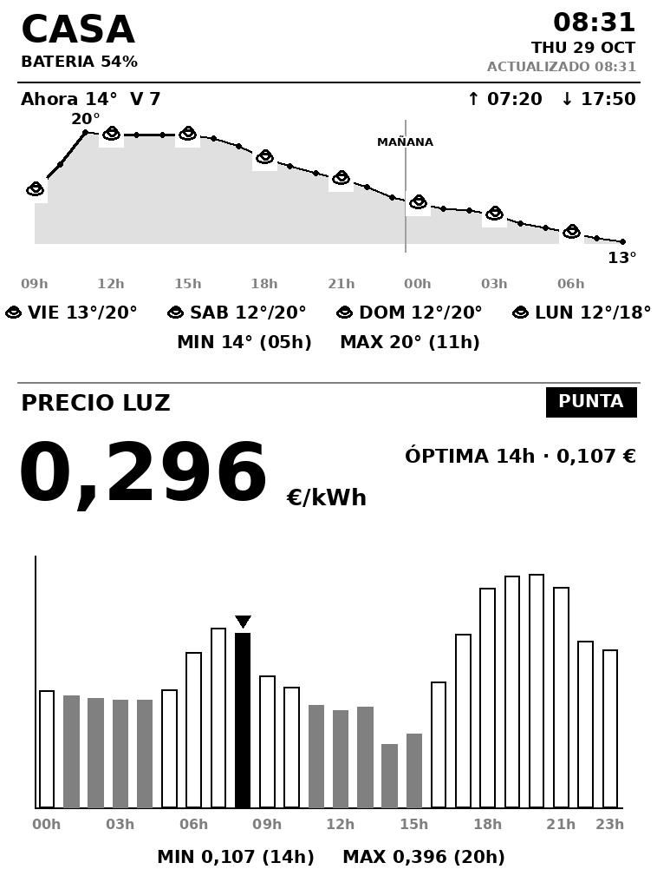

# Kindle × Home Assistant — salvapantallas e-ink "vivo"

Convierte un Kindle Paperwhite antiguo en un salvapantallas de Home Assistant
que se **actualiza cada hora, 24 h/día**, mostrando:

- Pronóstico del tiempo de tu entidad `weather.*`: **curva horaria de
  temperatura** de las próximas ~24 h (área rellena, iconos cada 3 h, máx/mín
  etiquetados, cambio de día), sol (↑ amanece ↓ atardece), barras de
  probabilidad de lluvia, strip compacto de los días siguientes y pie
  `MIN`/`MAX (XXh)` del día en curso
- Precio de la luz PVPC (España): precio actual, badge `VALLE`/`MEDIO`/`PUNTA`,
  `ÓPTIMA HHh · 0,XXX €` (la hora más barata del día), barras 24 h, `MIN`/`MAX`
- Batería del propio Kindle (cabecera) y aviso en HA si baja del 20 %

Renderizado con Pillow en el servidor (imagen PNG 758×1024, 8-bit gris, alto
contraste para e-ink). El Kindle la descarga al suspenderse y cada hora con
despertar RTC, mientras duerme.



> **Aviso (disclaimer):** este proyecto lo hice **sin tener mucha idea**, trastecando
> por diversión y con mucha ayuda de IA (y de los foros de MobileRead). No lo uses
> como guía de referencia ni para nada crítico: sigue los pasos bajo tu propia
> responsabilidad, y el código puede tener errores — probablemente los tiene.

*Cabecera con batería, curva horaria de temperatura con sol y precipitación,
strip de los días siguientes, y precio de la luz PVPC protagonista: tramo
`PUNTA`/`MEDIO`/`VALLE`, precio actual, `ÓPTIMA HHh`, barras 24 h y `MIN`/`MAX`.*

## Índice

1. [Prerrequisitos](#1-prerrequisitos)
2. [Jailbreak del Kindle](#2-jailbreak-del-kindle)
3. [KOReader, KUAL y patcher](#3-koreader-kual-y-patcher)
4. [Home Assistant: integraciones](#4-home-assistant-integraciones)
5. [El servidor de screenshots por hora](#5-el-servidor-de-screenshots-por-hora)
6. [Instalación en el Kindle](#6-instalación-en-el-kindle)
7. [Herramientas útiles](#7-herramientas-útiles)
8. [Seguridad](#8-seguridad)
9. [Créditos](#9-créditos)

---

## 1. Prerrequisitos

- Un **Kindle e-ink** con jailbreak. Este proyecto está probado en un
  **Paperwhite 1ª gen (2012)**, pantalla **758×1024**. Si usas otro modelo,
  ajusta la resolución en `server/kindle-ha.py` (`W, H`) y ten en cuenta que
  los detalles del framework varían.
- Un **PC/servidor siempre encendido** en la misma red que el Kindle
  (yo uso un Intel Nuc, pero una raspberry funcionaria igual), con **Python 3**.
- **Home Assistant** funcionando y accesible desde ambos.

## 2. Jailbreak del Kindle

> ⚠️ Hacer jailbreak invalida la garantía y conlleva riesgos (brick). Tómate
> tu tiempo y lee bien tu modelo concreto. **Evita actualizar el firmware**
> por Internet durante el proceso.

Punto de entrada recomendado (wiki de la comunidad, con instrucciones por
modelo y firmware):

- **Kindle Modding Wiki** → <https://kindlemodding.org>

Referencias complementarias:

- Foro **Kindle Developer's Corner** de MobileRead (donde se publican los
  hacks, MRPI, KUAL, USBNetwork, etc.) →
  <https://www.mobileread.com/forums/forumdisplay.php?f=150>
- Wiki de MobileRead ( hacks / jailbreak ) →
  <https://wiki.mobileread.com/wiki/Kindle_Hacks_Information>

En el Paperwhite 1 el flujo clásico es: jailbreak → **MRPI** (instalador de
paquetes `.bin`) → **KUAL** (launcher) → **KOReader** (+ opcionalmente
**USBNetwork** para SSH por WiFi).

## 3. KOReader, KUAL y patcher

- **KOReader** (lector con soporte de "user patches"): descarga la build para
  tu Kindle desde <https://github.com/koreader/koreader/releases> y cópiala a
  `/mnt/us/koreader` (el ZIP trae el layout de carpetas).
- Instala **KUAL** y **MRPI** (hilos del Developer's Corner de MobileRead) para
  poder arrancar KOReader desde el menú del Kindle e instalar paquetes.
- KOReader aplica los parches de `koreader/patches/` al arrancar. Copia ahí
  `2-live-sleepscreen.lua` (editando antes `IMAGE_URL`, ver §6).

## 4. Home Assistant: integraciones

El PNG se compone de datos de dos entidades de HA (nombres configurables por
entorno en `server/.env`):

| Dato | Entidad de ejemplo | Cómo conseguirlo |
|---|---|---|
| Tiempo | `weather.home` | Cualquier integración de tiempo (Met.no es built-in) |
| Precio luz (España) | `sensor.esios_pvpc` | Integración **Spain electricity hourly pricing (PVPC)**, built-in → <https://www.home-assistant.io/integrations/pvpc_hourly_pricing> |

Además, el **plugin heartbeat** (batería del Kindle → HA) publica
`binary_sensor.koreader_status` con atributos `battery_level`, `is_charging`,
`last_seen`. Añade a tu `configuration.yaml` el sensor plantilla y la
automatización de aviso de "batería baja" de [`ha/home-assistant.yaml`](ha/home-assistant.yaml).

> Si el servidor no arruja y se queja de que no encuentra las fuentes DejaVu,
> instala el paquete de tu distra (`fonts-dejavu` / `dejavu-sans-fonts` /
> `ttf-dejavu`) o fija `FONT_DIR` en `.env` (ver `.env.example`).

Necesitas un **token de acceso de larga duración** (Perfil → Seguridad →
Tokens de acceso de larga duración) para el servidor de render y para el
heartbeat.

## 5. El servidor de screenshots por hora

`server/kindle-ha.py` es el "programa de screenshots": cada vez que el Kindle
duerme (o despierta a la hora en punto), hace un `GET` a este servidor, que
consulta HA por REST, **dibuja el PNG con Pillow** y lo devuelve; además
registra la batería que el Kindle envía en la URL
(`?battery=NN&charging=0/1`) en `state.json`.

```
Kindle (KOReader + parche live-sleepscreen)
  └─ GET http://TU-PC:8090/kindle.png?battery=54&charging=0
        └─ server/kindle-ha.py  →  consulta HA (clima + PVPC)  →  PNG 758×1024
El refresco horario lo programa el parche con el wakeup manager de KOReader
(RTC a la hora en punto, reconexión WiFi incluida).
```

Detalles que conviene conocer:

- **Cache de datos HA** con TTL configurable (`DATA_TTL`, por defecto 300 s);
  las entidades se fijan con `WEATHER_ENTITY`, `PRICE_ENTITY` y el título de la
  cabecera con `TITLE` (ver `.env.example`).
- **Histórico horario del día** (`weather_hours.json`, autogenerado junto al
  script): HA solo devuelve horas *futuras* en el forecast horario; el servidor
  acumula las temperaturas del día en cada fetch para poder pintar el pie
  `MIN XX° (HHh) / MAX XX° (HHh)` con horas reales.
- **Refresco de fondo**: un hilo interno reconsulta HA cada hora si el Kindle no
  fetchea (está dormido o falló un ciclo), para que el histórico y la caché no
  se queden a medias.
- **Sincronización de reloj**: cada respuesta lleva `X-Host-Epoch` (epoch del
  host); el parche (`syncClock`) corrige solo la desviación sub-horaria del
  reloj del Kindle, para que las alarmas RTC sigan cayendo en el `:00` del host
  (sin esto, las actualizaciones se disparaban a las `xx:59`).

Instalación del servidor:

```bash
cd server
python3 -m venv ../venv
../venv/bin/pip install pillow requests

cp .env.example .env
# edita .env: HA_URL, HA_TOKEN, WEATHER_ENTITY, PRICE_ENTITY

chmod +x run.sh && ./run.sh          # prueba manual en :8090
curl -o /tmp/k.png 'http://127.0.0.1:8090/kindle.png?battery=80&charging=0'
```

Para dejarlo como servicio (systemd):

```bash
sudo cp kindle-screensaver.service.example /etc/systemd/system/kindle-screensaver.service
# edita WorkingDirectory, ExecStart y User
sudo systemctl daemon-reload && sudo systemctl enable --now kindle-screensaver
journalctl -u kindle-screensaver -f
```

> La primera carga de datos la caché tarda en llenarse; si la imagen sale
> "SIN DATOS HA", revisa `HA_URL`, `HA_TOKEN` y los nombres de entidades.

## 6. Instalación en el Kindle

Con el Kindle conectado por USB (o SSH):

1. **Parche**: copia `koreader/patches/2-live-sleepscreen.lua` a
   `/mnt/us/koreader/patches/` y edita su bloque `CONFIG`:
   - `IMAGE_URL = "http://IP-DE-TU-PC:8090/kindle.png"`
   - Ventana de despertares (`WAKE_HOUR_MIN/MAX`) y marcas horarias.
   - Flags de emergencia (crear/borrar ficheros en la raíz USB):
     `live-sleepscreen.nowake` (desactiva despertares) y
     `live-sleepscreen.fasttest` (despertar cada 5 min para probar).
   - El parche sincroniza automáticamente su reloj con el servidor en cada
     fetch (`X-Host-Epoch` → `syncClock`); si tu servidor no es
     `kindle-ha.py`, esta parte no hará nada.
2. **Pantalla de reposo**: copia también `koreader/patches/koreader.settings.lua`
   (o pega sus claves en tus settings) para que el salvapantallas de KOReader
   muestre `wallpaper.png` sin mensajes.
3. **Salvapantallas nativo del firmware**: para que no pinte su imagen de
   citas encima de la nuestra, mueve los PNG nativos:
   ```bash
   # en el Kindle, como root
   mntroot rw
   mkdir -p /usr/share/blanket/screensaver/disabled
   mv /usr/share/blanket/screensaver/bg_ss*.png /usr/share/blanket/screensaver/disabled/
   mntroot ro
   ```
4. **Guardia anti-doble-instancia** (evita peleas de salvapantallas al
   desbloquear): en `/mnt/us/koreader/koreader.sh`, tras `cd "${KOREADER_DIR}"`,
   añade:
   ```sh
   [ -n "$(pidof reader.lua)" ] && { logmsg "KOReader already running; not starting a second instance"; exit 0; }
   ```
5. **Plugin heartbeat** (batería → HA): el plugin está **incluido en este repo**
   (§ "Créditos": es el de Moritz John, licencia MIT). Copia la carpeta completa
   `koreader/plugins/heartbeat.koplugin/` a `/mnt/us/koreader/plugins/` y edita ahí
   la plantilla de config [`heartbeat_config.lua`](koreader/plugins/heartbeat.koplugin/heartbeat_config.lua)
   con tu IP de HA y tu token. Ajusta el nombre del sensor desde el menú del
   plugin (Tools → Heartbeat Configuration → Sensor Name).
6. Reinicia KOReader, duerme el Kindle y verifica: imagen actualizada al
   dormir y cada hora.

## 7. Herramientas útiles

- **`tools/kindle-ssh.py`** — helper SSH hacia el Kindle (dropbear de
  KOReader, puerto 2222):
  ```bash
  python3 tools/kindle-ssh.py "grep live-sleepscreen /mnt/us/koreader/crash.log | tail -20" IP-DEL-KINDLE
  ```
  Notas del BusyBox del Kindle: no hay `nohup` (usar `setsid`), `timeout -t SECS PROG`,
  acaba los comandos con `; echo __DONE__`.
- Logs del Kindle: `/mnt/us/koreader/crash.log`.

## 8. Seguridad

- El dropbear de KOReader en el puerto 2222 **sin contraseña** es cómodo para
  pruebas pero cualquier equipo de tu red entra como root. Ponle contraseña o
  usa USBNetwork con claves.

## 9. Créditos

- Parche `2-live-sleepscreen.lua` basado en
  [koreader-live-sleepscreen](https://github.com/file99/koreader-live-sleepscreen)
  (MIT, © file99), muy ampliado aquí (blindaje de `lipc`, watchdog de
  despertadas, refresco horario 24 h, refresco completo anti-ghosting).
- Plugin [heartbeat.koplugin](https://github.com/moritz-john/heartbeat.koplugin)
  de Moritz John (MIT), incluido en `koreader/plugins/heartbeat.koplugin/`
  (batería del Kindle → `binary_sensor` en HA).
- [KOReader](https://koreader.rocks) · [Home Assistant](https://www.home-assistant.io)
  · [Kindle Modding Wiki](https://kindlemodding.org) · MobileRead.
- Proyecto desarrollado con [pi](https://github.com/earendil-works/pi), un
  agente de código que trabaja desde la terminal.
- Licencia: [MIT](LICENSE) — usa el proyecto como quieras, trastéalo a gusto;
  cualquier duda, [abre un issue](../../issues) y me escribes.

